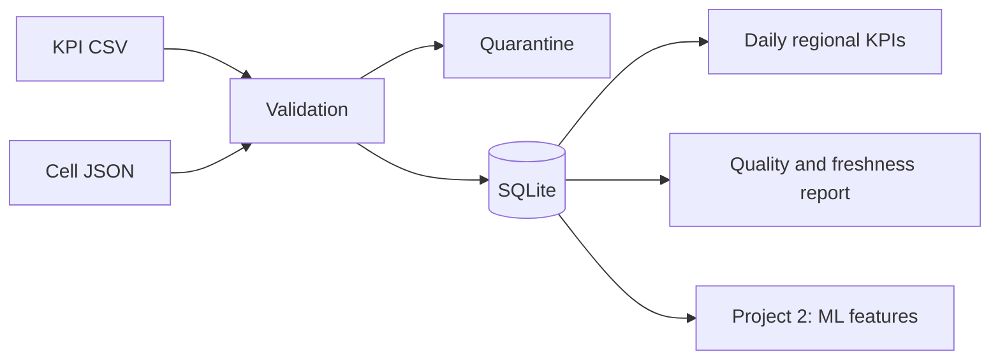

# Data Engineering Lab

Two small personal portfolio projects built with AI assistance in October 2026.
They use **synthetic telecom records**, not Huawei/customer data, and run with
Python 3.11+ and its standard library. No services, credentials or paid accounts
are required. These are local demonstrators, not production systems.

## Run

```sh
python -m unittest discover -s tests -v
python -m datalab demo --out artifacts
```

The demo accepts 12 rows, quarantines 2 bad rows, reports data freshness and quality,
and exports 4 training and 4 test feature rows. Generated files stay local in
`artifacts/`. The committed fixtures are intentionally tiny; no throughput or
large-scale performance claim is made.

## Project 1 � Multi-source ETL and data-quality monitoring

CSV measurements and a JSON cell dimension are validated and joined in SQLite.
The loader checks schema, timezone-aware timestamps, finite/nonnegative metrics,
referential integrity and duplicate business keys. Invalid rows retain their
original content and rejection reasons in a quarantine table.

An explicit transaction atomically replaces a snapshot. Reprocessing the same
sources produces the same logical records and lineage hashes without duplicates.
A SQL view aggregates daily KPIs by region; an index supports time filtering.
Freshness, empty datasets and rejection-rate thresholds are monitored with an
explicit evaluation timestamp for reproducibility.



## Project 2 � Point-in-time ML feature datasets

The second pipeline consumes accepted observations and generates lagged throughput
and historical window means. Features use strictly earlier observations of the
same cell. A chronological cutoff separates train/test CSVs. A manifest records
source hashes, parameters, feature names, row counts and output hashes, producing
a reproducible SHA-256 dataset version. No model is trained and no predictive
performance is asserted.

The evaluation contract is sequential, one-step-ahead prediction: earlier test
measurements may be used once observed. It is not a fixed-horizon forecast. Tests
verify actual feature values and that future changes cannot change training rows.

## Inspect the outputs

* `artifacts/telecom.sqlite`: `cells`, `observations`, `quarantine`, `lineage`,
  and the `daily_region_kpis` view.
* `artifacts/report.json`: ETL counts and health checks.
* `artifacts/features/{train,test}.csv`: point-in-time features and targets.
* `artifacts/features/manifest.json`: provenance and dataset fingerprint.

## Limits and next steps

Batch-only snapshot replacement; no streaming, scheduler, automatic retries,
distributed compute, cloud deployment, authentication or production SLAs.
SQLite is used deliberately for reproducibility. A production design would need
incremental ingestion, operational observability, access controls and a measured
choice of database/orchestrator. GitHub Actions runs the test and demo commands;
local test success alone does not establish that remote CI has passed.

AI assisted implementation and documentation. The accompanying tests and demo
make the scope reviewable; this is not represented as prior professional work.
